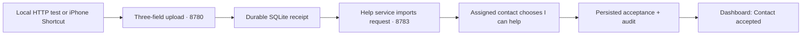
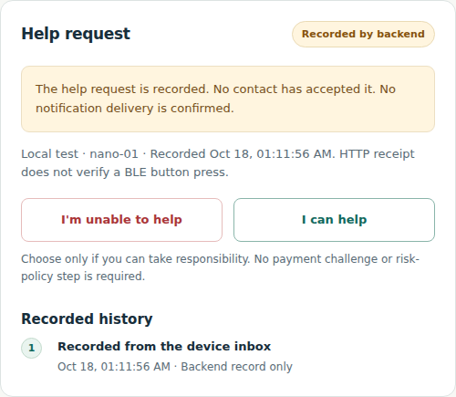
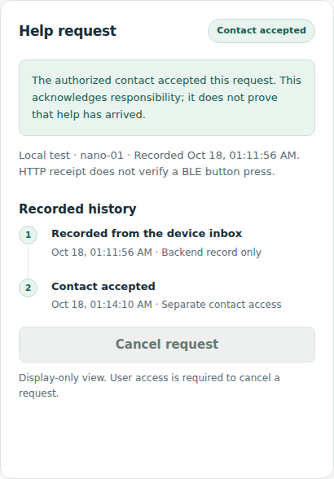

<div align="center">

# ReachGuard

**A request for help should lead to a visible human response.**

Authenticated requests · Separate contact access · Visible acknowledgement

[Evidence](#actual-software-test-screenshots) · [Demo](#run-the-software-demo) · [Status](#what-works-today) · [Sentry](#sentry-logs-and-tracing) · [Operator handoff](#next-operator-session) · [Credits](#sources-and-credits)

</div>

ReachGuard records a help request, lets an assigned contact explicitly choose **I can help**, and shows **Contact accepted** on a separate Dashboard. Upload success means the backend saved the request. Acceptance means the contact acknowledged responsibility; it does not mean help has arrived.

The recorded software rehearsal uses a deliberately marked local HTTP client over public HTTPS. Separately, the teammate reports a real button → BLE → Swift → backend receipt, supported by an App screenshot relayed by the operator and matching backend records checked directly. Contact acceptance for those hardware-origin events remains pending in the recorded snapshot; the full hardware-to-contact loop is not yet accepted.

## The acknowledgement loop



Opening the contact page does not accept a request. Device, contact, owner and Dashboard access are separate. A device gateway cannot accept its own request using its upload credential.

## Actual software-test screenshots

These are state-card captures from the **running application**, using actual role authentication and persisted state. No API responses or UI states were substituted. The uploader was a local HTTP client over public HTTPS; the human operator subsequently clicked **I can help**. These browser captures are not iPhone screenshots or BLE evidence.

<table>
<tr><th>Contact · before the human response</th><th>Dashboard · after the human response</th></tr>
<tr>
<td valign="top"></td>
<td valign="top"></td>
</tr>
</table>

*Actual software-test state cards, captured before and after the operator's manual response. Credentials, other requests and browser address bars are outside the captures. The image files are unchanged.*

The same test has one applied acceptance, reconciled with its backend receipt and audit history. The receipt-to-acceptance interval includes human waiting and is not server latency. [Exact timestamps, event reconciliation, capture provenance and timing limits](docs/REACH_SOFTWARE_TEST_2026-10-18.md).

## Run the software demo

The operator supplies current HTTPS origins and separate role credentials through a trusted channel. Temporary tunnel addresses and credentials are deliberately absent from this repository.

1. **Choose and label the client.** Use a Shortcut for a phone rehearsal, or an operator's local HTTP client for a software-only rehearsal. Report which one was actually used. POST to `/api/device-events`, with `Authorization: Bearer <device credential>` and `Content-Type: application/json`. Use a new, explicitly marked software-test ID:

   ```json
   {
     "event_id": "local-test-http-<unique-run-id>",
     "device_id": "nano-01",
     "event_type": "help_request"
   }
   ```

   Replace the ID marker with `local-test-shortcut-…` when the actual uploader is a Shortcut. First durable receipt returns **201 / received**. Retrying the same alarm must retain the same three fields and ID; it returns **200 / duplicate**. Neither result confirms contact delivery or acceptance.
2. **Inspect the request.** Open `/contact`, enter separate contact access, connect and select this test. New requests deliberately do not replace the current selection. Check **Local test** and **Recorded by backend**.
3. **Make the human decision.** The operator playing the contact taps **I can help** and waits for **Contact accepted**. An automated assistant must not make that decision for the demonstration.
4. **Verify the Dashboard.** Open `/`, connect with read-only Dashboard access, select the same request and inspect its acceptance history. The two-second browser polling interval is not server processing latency.

Keep access codes out of URLs, screenshots, source and telemetry. The Shortcut receives only the device upload credential; it never receives owner, contact or Dashboard credentials.

[The Swift/upload contract](docs/REACH_SWIFT_GATEWAY_CONTRACT.md) specifies schema, retries and error codes. [The phone runbook](docs/REACH_PHONE_HELP.md) covers role separation. Existing operators should follow [the recovery guide](docs/REACH_DEMO_RECOVERY.md), retaining existing identities and databases rather than rerunning initial provisioning.

For a separate development checkout, use Python 3.12:

```bash
python -m venv .venv
source .venv/bin/activate
python -m pip install -e '.[dev,observability]'
```

Read [device configuration](docs/DEVICE_EVENTS.md) before starting 8780 and [the integration handoff](docs/REACH_INTEGRATION_HANDOFF.md) before starting 8783. The help demo does not require legacy payment, speech or reviewer services.

## What works today

| Capability | Evidence and boundary |
| --- | --- |
| Three-field help ingestion | Authenticated, device-scoped upload; durable receipt and persistent same-event deduplication. |
| Contact response and Dashboard | Independent help state, assigned contact acceptance/unable responses, owner-only cancellation, read-only Dashboard and audit. Tests cover permissions and state races; real-phone evidence is narrower. |
| Local HTTP → manual contact acceptance | An explicitly marked test uploaded over actual public HTTPS; operator clicked acceptance; reconciliation found exactly one applied contact acceptance and Dashboard displayed accepted. See [this rehearsal](docs/REACH_SOFTWARE_TEST_2026-10-18.md). |
| Shortcut → iPhone contact acceptance | Operator-confirmed software/phone run, reconciled with persisted receipt and acceptance; see [phone evidence](docs/IPHONE_HELP_VERIFICATION_2026-10-17.md). This does not prove a button press. |
| Sentry Logs and Traces | Actual SDK envelopes accepted and both data types operator-confirmed visible in the configured project; see [acceptance](docs/SENTRY_OBSERVABILITY.md). Exact business-event correlation has the limits below. |
| Foreground Swift BLE gateway | Source on the team's [separate iOS branch](https://github.com/Cyberchopin/reachguard/tree/feat/reach-ios-gateway/ios). Teammate reports real-phone BLE/ACK and backend upload passing; source provenance is reported, backend receipts are checked directly, and hardware-event contact acceptance remains pending. |
| Hardware-origin upload report | Teammate reports real button/BLE/Swift delivery; the operator relays an App screenshot showing Medical / Recorded by backend. The backend independently contains the matching help requests. Hardware-event contact acceptance and the full loop remain pending; see [receipt reconciliation](docs/REACH_HARDWARE_RECEIPTS_2026-10-18.md). |
| `alert_type`, device cancellation, device help-status lookup | Not implemented in the backend device contract. Extra upload fields are rejected. Do not lend help-role credentials to the device App. |
| Notifications, escalation, location, emergency dispatch, arrival confirmation | Not implemented. A person opens the contact page; there is no automated emergency-service delivery. |

Acceptance establishes an action by an authorized application role, not independently verified human identity. Free tunnels are a demo transport, not stable hosting or a production availability claim.

## Sentry Logs and Tracing

The optional Python SDK uses **actual transactions/spans and structured Sentry Logs**, filtered before transmission:

- `device.upload` / `device.persist`: upload handling and the SQLite transaction boundary.
- `help.sync` / `help.persist`: inbox import and help-state/audit storage boundaries.
- `help.response`: the contact response HTTP operation.
- `help.read` / `help.list`: authorized status reads.

Logs keep fixed operation names, outcomes, measured duration, optional HTTP status and generated trace/span IDs. They omit credentials, bodies, event/device/actor IDs, SQL, private URLs, database paths and exception text. Automatic SDK integrations are disabled. [The observability record](docs/SENTRY_OBSERVABILITY.md) documents the actual DSN-path 404 diagnosis, corrected smoke envelopes returning 200, and subsequent operator-confirmed UI visibility. No secret is committed.

For the local HTTP rehearsal, the operator supplied actual `device.upload` and `device.persist` logs sharing one trace, then opened its Sentry Trace detail and confirmed both steps. The contact-response Trace remains unverified. [Measured durations and evidence boundaries](docs/REACH_SOFTWARE_TEST_2026-10-18.md) distinguish server work, client round-trip time and human waiting.

### Read the timings honestly

| Measurement | Measures | Does not measure |
| --- | --- | --- |
| `device.upload` duration | Server middleware work through the response object | BLE delivery, Shortcut/Internet round trip, contact response time |
| `device.persist` / `help.persist` | Instrumented SQLite context including commit/rollback; some contexts also serve reads | A complete breakdown of storage subsystem costs |
| `help.sync` | One import/check operation, potentially zero or multiple events | Time between polls, or per-event processing by itself |
| `help.response` | Server handling of the submitted contact action | Human deliberation before the tap |
| `help.read` / `help.list` | Server status-read/list work | Browser polling and rendering delay |
| Receipt → import → acceptance timestamps | Business chronology, with polling, network and human waiting where applicable | Server latency benchmarks or an SLA |

Within an operation, trace/span IDs directly connect logs and spans. **There is no distributed trace spanning the inbox service, background help import and later contact/browser request.** Event IDs are deliberately omitted from telemetry: database timestamps narrow a Sentry time window but cannot prove exact event-to-trace identity. Do not sum nested durations or count human waiting as backend latency.

## Next operator session

Use [the overnight handoff and shortest acceptance sequence](docs/REACH_OVERNIGHT_HANDOFF_2026-10-18.md) to recover current entry points, distinguish a rotated tunnel from a stopped service, and finish the remaining hardware/contact and Sentry checks. It also records the PR review/merge order. Do not restart healthy services for documentation or retry an old accepted software test as new evidence.

## Sources and credits

ReachGuard builds on **CallGate**, an existing MIT-licensed codebase with speech-risk research, simulated payment verification, tests and documentation. Runnable work predates this event; the entire repository is not claimed as hackathon-built. The new repository imported that snapshot at `ad83e91`. [BUILD_LOG.md](BUILD_LOG.md) and [the corrected historical boundary notice](PRE_HACKATHON_BOUNDARY.md) preserve that distinction. [The legacy CallGate README](CALLGATE_README.md) retains its overview and evaluation limitations.

- **Reach backend/web:** device inbox, independent help state, scoped pages, recovery and observability are documented in the handoff/build log. Sentry synchronization is recorded in `454e3c0`.
- **iOS gateway:** maintained on `feat/reach-ios-gateway`. Its handoff credits the protocol to the team's [wearable firmware repository](https://github.com/Iridium0317/WearableEmergencyAssistanceSystem). Attribution does not establish hardware validation.
- **Sentry:** its Python SDK and hosted Logs/Tracing provide the observed telemetry path; a smoke test establishes neither performance improvement nor a production SLA.
- **Inherited components:** [THIRD_PARTY.md](THIRD_PARTY.md) retains model/code provenance and license limitations. AssemblyAI, Silero and legacy evaluations belong to the inherited speech/payment work, not the help-only demo's prerequisites.

The root [MIT license](LICENSE) and third-party notices remain intact. This demo claims no real payment, emergency dispatch, confirmed arrival or independently validated detection accuracy.
