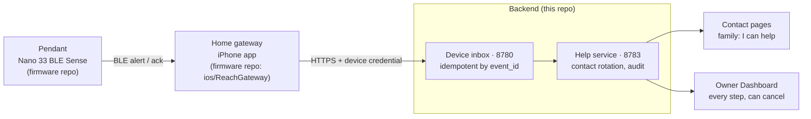
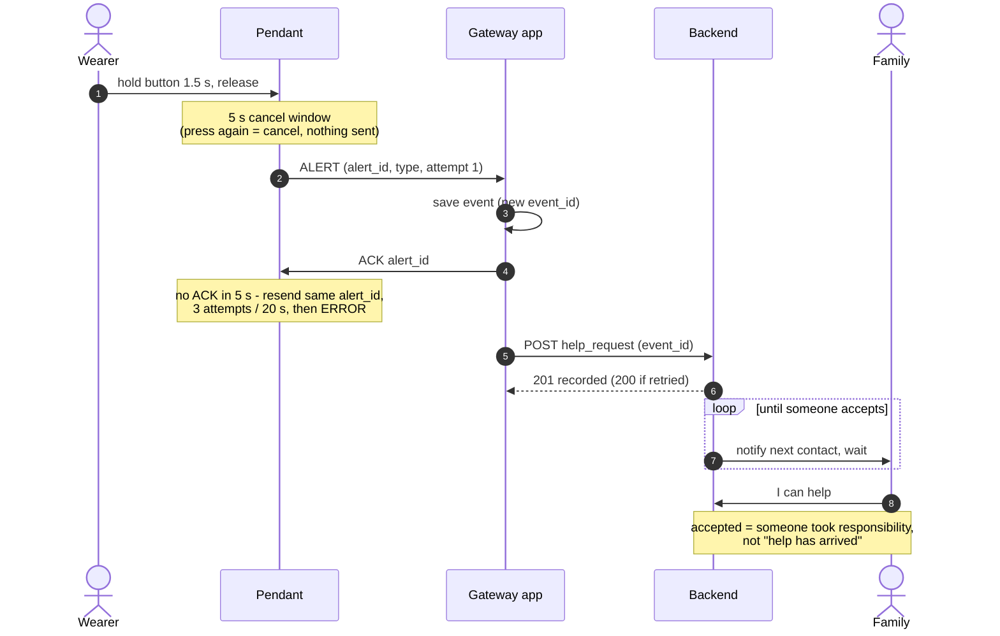

# Reach system architecture

How one press on the pendant becomes a visible human response, across both
repositories:

- Pendant firmware and the iPhone home gateway:
  [Iridium0317/WearableEmergencyAssistanceSystem](https://github.com/Iridium0317/WearableEmergencyAssistanceSystem)
- Device inbox, help service, contact pages and Dashboard: this repository

The wearer only has the pendant; they are not expected to own or use a
smartphone. A home gateway relays alerts to the internet. In this prototype the
gateway is an iPhone running the ReachGateway app, standing in for a spare
phone kept plugged in at home. Family members respond on the contact page; a
primary family member (the owner role, for example the wearer's son) follows
every step on the Dashboard.

## Components

## Life of one alert

The rotation loop was added in [PR #5](https://github.com/Cyberchopin/reachguard/pull/5)
and is enabled with `--contacts`; without it the help service notifies one
assigned contact, as described in the README. "I can't help" passes the request
to the next contact; it ends only when every contact has declined.

## Design decisions

Evidence IDs (T#) refer to
[TEST_RESULTS.md in the firmware repo](https://github.com/Iridium0317/WearableEmergencyAssistanceSystem/blob/main/TEST_RESULTS.md).

| Decision | Why | Evidence |
|---|---|---|
| A deliberate 1.5 s hold, then a 5 s cancel window before anything is sent | False alarms are the main failure of alert buttons; short presses and contact bounce must never alert, and a wrong press must be undoable | T6–T8 |
| An explicit application ACK for every alert | A BLE notification is not a delivery confirmation; only the gateway's ACK counts | T5, T9 |
| Bounded retries (3 attempts, 20 s), then a sticky ERROR | The wearer must never see "sent" for an alert nobody received; failure is shown, not hidden | T5, T10 |
| The gateway saves an alert before it ACKs | An ACK is a promise to keep the alarm; if the phone cannot save it, no ACK is sent and the pendant falls back to ERROR | T13, T15, T17 |
| `event_id`: attempt 1 always creates a new ID, a retry reuses it | `alert_id` restarts at 1 after a board reset, so it cannot be the identity; retries must not create a second help request (the inbox also answers 200 for a repeated ID) | T15 |
| Upload retries transient failures with the same ID, and stops on credential or schema errors | Retrying cannot fix a wrong credential; the reason is shown and a manual retry keeps the original ID | T13 |
| "Received", "recorded" and "accepted" are three different claims | BLE ACK = the gateway has it; HTTP 201 = the backend recorded it; accepted = a contact took responsibility. None of them means help arrived | T14 |
| The gateway is silent | It stands in for a device left at home; telling family is the backend's job | — |
| Rotation lives in the backend; the wearer presses once | Keep the wearer's side simple and put the complexity in the system: close family first, alternating, then others, round after round until someone accepts. After downtime it resumes one step at a time instead of firing every missed notification | PR #5 tests |
| Least-privilege credentials | The gateway holds only the device credential (iOS Keychain); contact, owner and Dashboard roles are separate; nothing is committed | — |

## Limits

- Not a medical device and not connected to emergency services.
- The contact page only shows a request while it is open; there are no calls,
  SMS or push notifications.
- The wearer cannot talk to the family member who accepts; there is no voice
  path in this prototype.
- Timings (1.5 s hold, 5 s cancel window, contact wait) are prototype defaults,
  not validated with older users.
